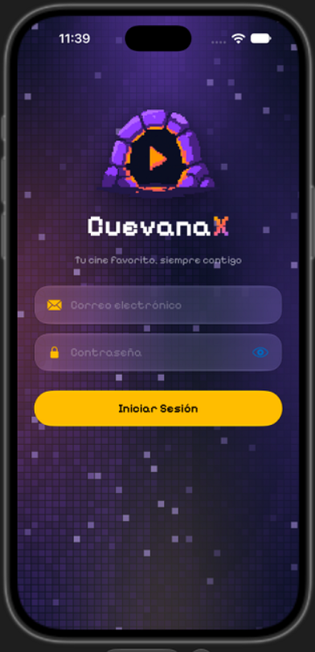
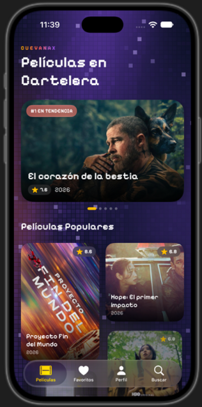
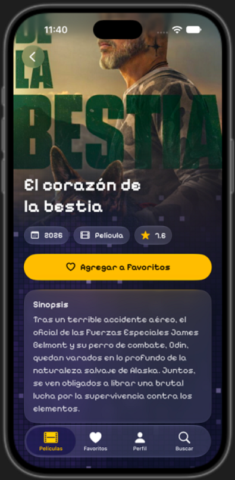
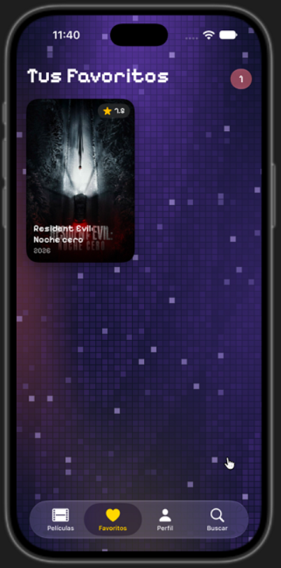
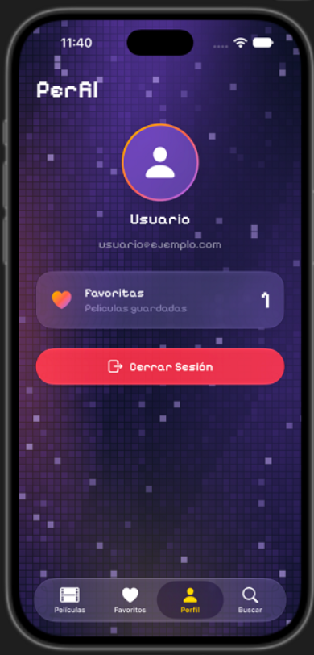
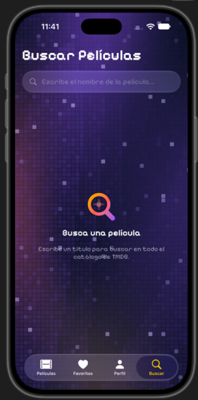

# CuevanaX

App de iOS para explorar películas en cartelera, buscarlas por nombre y guardar tus favoritas, usando la API de TMDB.

## Descripción

Cuando alguien quiere ver una película normalmente busca en varios sitios para saber qué hay en cartelera, de qué trata y si vale la pena. CuevanaX junta eso en una sola app: muestra las películas populares del momento, permite buscar cualquier título del catálogo de TMDB y guardar las que te interesan para verlas después, incluso sin conexión.

## Funcionalidades

- **Login** con correo y contraseña. Si algún campo está vacío muestra un mensaje de error.
- **Películas en cartelera**: carrusel con las 5 películas en tendencia y un grid tipo Pinterest con las populares. Botón "Cargar más" para traer la siguiente página.
- **Detalle de película**: póster, año, género, calificación, sinopsis y botón para agregar o quitar de favoritos.
- **Búsqueda** en todo el catálogo de TMDB mientras escribes.
- **Favoritos** guardados en el teléfono con SwiftData. Se mantienen al cerrar la app y se quitan manteniendo presionada la película.
- **Perfil** con el número de favoritas y botón para cerrar sesión.
- Estados de carga, vacío y error con botón de reintentar.

## Tecnologías

- Swift y SwiftUI
- Arquitectura MVVM con `@Observable`
- [TMDB API](https://developer.themoviedb.org/docs)
- SwiftData para los favoritos
- [WaterfallGrid](https://github.com/paololeonardi/WaterfallGrid) 1.1.0 (Swift Package Manager)
- PixelKit (carpeta `PixelKit`): paquete local con el fondo mosaico pixel
- Fuente Pixelify Sans (licencia OFL) en `Cuevana/Fonts`
- XCTest para pruebas unitarias y de UI

## Requisitos

- Mac con Xcode 26 o superior
- Simulador o iPhone con iOS 26 o superior
- Conexión a internet
- Una cuenta gratuita de [TMDB](https://www.themoviedb.org/signup) para obtener el token de la API

## Instalación y configuración

1. Clona el repositorio:
   ```bash
   git clone https://github.com/hexab1t3/CuevanaX.git
   ```
2. Abre `Cuevana.xcodeproj` en Xcode. La primera vez Xcode descarga WaterfallGrid solo.
3. Configura el token de TMDB (siguiente sección).

## Configuración de servicios externos (TMDB)

La app necesita un **token de lectura (Bearer)** de TMDB. El token **no está en el repositorio**.

1. En tu cuenta de TMDB ve a **Ajustes → API** y copia el *API Read Access Token*.
2. Copia el archivo de ejemplo:
   ```bash
   cp Cuevana/Secrets.plist.example Cuevana/Secrets.plist
   ```
3. Abre `Cuevana/Secrets.plist` y reemplaza `TU_TOKEN_BEARER_AQUI` por tu token.

`Secrets.plist` está en `.gitignore`, así que no se sube a GitHub. También puedes usar la variable de entorno `TMDB_BEARER_TOKEN` en el esquema de Xcode. Sin token la app muestra la pantalla de error.

## Ejecución

1. En Xcode elige un simulador de iPhone con iOS 26 o superior.
2. Presiona **Cmd + R**.
3. En el login escribe cualquier correo y contraseña (solo se valida que no estén vacíos).

Para correr las pruebas presiona **Cmd + U**.

## Capturas y accesibilidad

Capturas de la versión final. Debajo de cada una se listan, en orden, los elementos que VoiceOver le lee a las personas con discapacidad visual en esa pantalla.

<table>
  <tr>
    <td valign="top" width="33%">
      
      <h4>Vista Login</h4>
      <ul>
        <li>Le dice el logo: CuevanaX</li>
        <li>Le dice el nombre de la app y la frase «Tu cine favorito, siempre contigo»</li>
        <li>Le dice Correo electrónico (Campo de texto)</li>
        <li>Le dice Contraseña (Campo de texto seguro)</li>
        <li>Dice mostrar contraseña (Botón)</li>
        <li>Dice iniciar sesión (Botón)</li>
      </ul>
    </td>
    <td valign="top" width="33%">
      
      <h4>Vista Películas</h4>
      <ul>
        <li>Le dice el título Películas en Cartelera</li>
        <li>Le dice la película destacada: su lugar en tendencia, el nombre, la calificación y el año</li>
        <li>Le dice la sección Películas Populares</li>
        <li>Le dice el nombre de cada película, el año y la calificación</li>
        <li>Dice que se puede abrir el detalle (Botón)</li>
        <li>Dice cargar más (Botón)</li>
        <li>Le dice el menú inferior de 4 opciones: Películas, Favoritos, Perfil y Buscar</li>
      </ul>
    </td>
    <td valign="top" width="33%">
      
      <h4>Vista Detalle</h4>
      <ul>
        <li>Dice regresar (Botón)</li>
        <li>Le dice el título de la película</li>
        <li>Le dice el año, el género y la calificación</li>
        <li>Dice agregar a favoritos o quitar de favoritos (Botón)</li>
        <li>Le lee la sinopsis</li>
      </ul>
    </td>
  </tr>
</table>

<table>
  <tr>
    <td valign="top" width="33%">
      
      <h4>Vista Favoritos</h4>
      <ul>
        <li>Le dice el título Tus Favoritos</li>
        <li>Le dice cuántas películas favoritas tiene</li>
        <li>Le dice el nombre de cada película, el año y la calificación</li>
        <li>Dice que se puede abrir el detalle (Botón)</li>
        <li>Al mantener presionada una película, dice quitar de favoritos (Botón)</li>
      </ul>
    </td>
    <td valign="top" width="33%">
      
      <h4>Vista Perfil</h4>
      <ul>
        <li>Le dice el título Perfil</li>
        <li>Le dice el nombre y el correo del usuario</li>
        <li>Le dice cuántas películas favoritas tiene guardadas</li>
        <li>Dice cerrar sesión (Botón)</li>
      </ul>
    </td>
    <td valign="top" width="33%">
      
      <h4>Vista Buscar</h4>
      <ul>
        <li>Le dice el título Buscar Películas</li>
        <li>Le dice Escribe el nombre de la película (Campo de texto)</li>
        <li>Le dice Busca una película</li>
        <li>Le dice que escriba un título para buscar en todo el catálogo de TMDB</li>
      </ul>
    </td>
  </tr>
</table>

## Documentación técnica

- [Documentación técnica](Docs/documentacion-tecnica.md): arquitectura, networking, persistencia, decisiones técnicas y limitaciones.
- [Navegación y estado](Docs/navigation-and-state.md)
- [Investigación MVVM](Docs/investigacion-mvvm.md)

## Integrantes

- Fernando Miranda Romero
- Leonardo Alarcón García

## Licencia

GPL-3.0. Ver [LICENSE](LICENSE).
